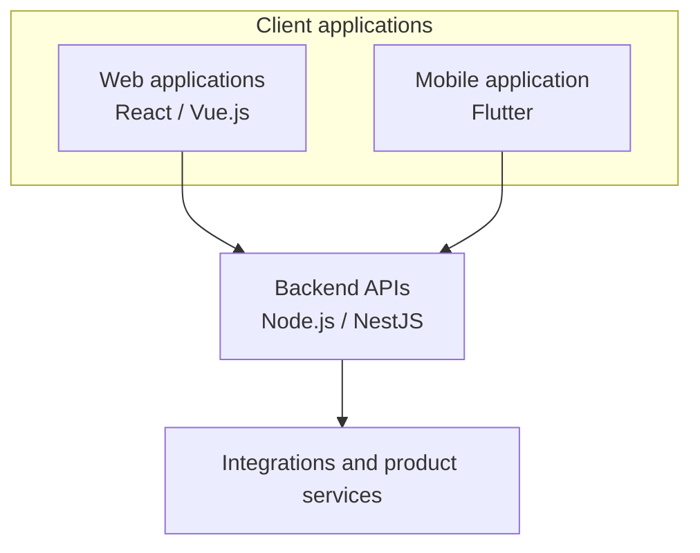
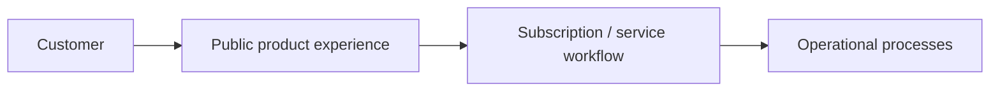

# Professional Case Studies

This page describes selected professional work at a high level. Source code, production credentials, customer records, and confidential implementation details are intentionally excluded.

## QInspecting — Inspection Management SaaS

**Product context:** a SaaS product with web, backend, and mobile components supporting inspection-related workflows.

### Technology landscape

- **Web:** React and Vue.js
- **Backend:** Node.js and NestJS
- **Mobile:** Flutter

### Contribution

- Developed Full Stack features across the product.
- Integrated frontend experiences with backend APIs and external services.
- Contributed product improvements and technical troubleshooting.
- Supported issues and coordinated follow-up improvements.

### High-level architecture

This diagram represents the technology boundaries at a high level; it intentionally omits private infrastructure, data models, and customer-specific flows.

### Portfolio evidence to add

Use only screenshots that are approved for external sharing. Before adding them, replace or obscure names, emails, inspection details, addresses, company logos where restricted, and any production identifiers. If real screenshots cannot be shared, create a clearly labeled demo using mock data rather than presenting a mockup as a production screenshot.

Recommended visual set:
1. A main workflow screen with mock data.
2. A detail or report view with all identifying information removed.
3. A simple diagram showing the web/mobile/API boundaries.

## Ruedaz — Parking Subscription Platform

**Public reference:** [ruedaz.com](https://ruedaz.com/)

### Product and contribution

- Contributed to a parking subscription product.
- Designed the application architecture and infrastructure from the ground up.
- Worked as both development lead and hands-on developer.
- Supported integrations, improvements, and ongoing product needs.

### Conceptual product flow

The following is a conceptual view for explaining the product in a portfolio, not a claim about the exact production topology or technology stack.

### Portfolio evidence to add

The public website can be linked directly. For additional visuals, use approved screenshots of public-facing pages and annotate them with your contribution. If a screenshot shows a user or operational workflow, use a separate demo environment and mock data. Do not include source code, infrastructure diagrams with sensitive details, credentials, customer information, or internal admin screens without authorization.

Recommended visual set:
1. Public website screenshot or link to the live site.
2. A simple product journey diagram.
3. A short contribution summary explaining architecture, technical leadership, implementation, and integrations.

## Confidentiality and accuracy

These case studies describe the work at a professional level without publishing proprietary code or internal details. The diagrams are intentionally simplified and should not be interpreted as complete deployment diagrams. Add performance metrics, business outcomes, or specific integrations only when you can verify them and are permitted to disclose them.
